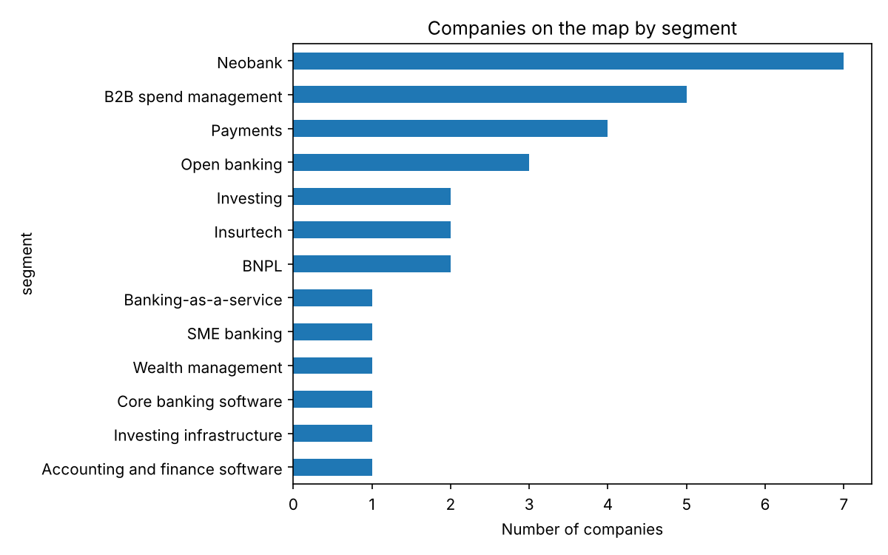
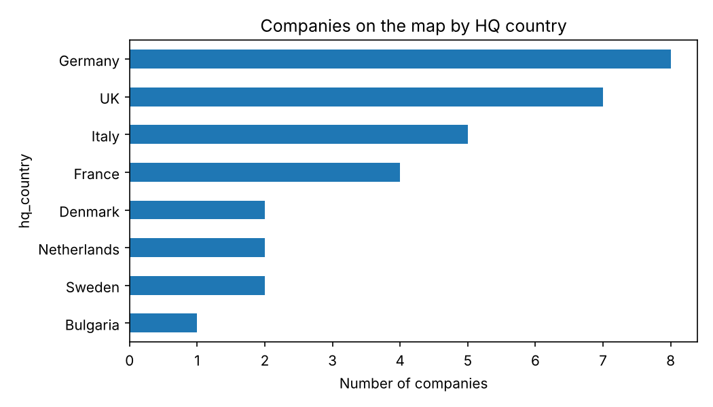

# European Fintech Market Map & Thesis Memo

A venture-style market map of 31 European fintech companies across 13 segments, with a Python script that summarises the map and a short investment-thesis memo on SME finance tools in Southern Europe.

**Author:** Paras Taneja

## Why this project
A VC analyst's first job is sourcing and market analysis: map a space, spot where it is crowded or thin, and form a view. This repo does that in a reproducible way.

## What is inside

| File | Purpose |
|---|---|
| `data/startups.csv` | 31 companies: HQ country, founding year, segment, business model, target customer, status. Funding columns are provided for you to fill in |
| `src/analyze.py` | Counts by segment and country, segment x country matrix, Italy vs rest of map, funding analysis once data is added |
| `memo/thesis_memo.md` | Draft thesis memo: what the map shows, hypotheses, risks, next steps |
| `outputs/` | Generated charts and the segment x country matrix |

## Key observations from the map
- Neobanks are the largest segment (7 of 31), followed by B2B spend management (5) and payments (4).
- Germany (8) and the UK (7) have the most companies on the map. Italy has 5.
- No Italian company appears in neobanking, open banking, SME banking, accounting software or banking-as-a-service. This is the gap the memo explores.




## Run it
```bash
pip install -r requirements.txt
python src/analyze.py
```

## Data and limitations
- The sample is hand-picked and biased toward well-known companies. It is **not** a complete census of European fintech.
- Company, country, founding year, segment and business model come from general public knowledge. Please verify details before relying on them.
- Funding, round and investor columns are left empty on purpose. They should be filled from primary sources (company announcements, Crunchbase, Dealroom) with a `source_url` for each row. The script produces funding charts automatically once at least 5 rows are filled.

## Next steps
Extend the map to 60+ companies, add funding data, and interview Italian SME owners to test the memo's hypotheses.

## License
MIT
